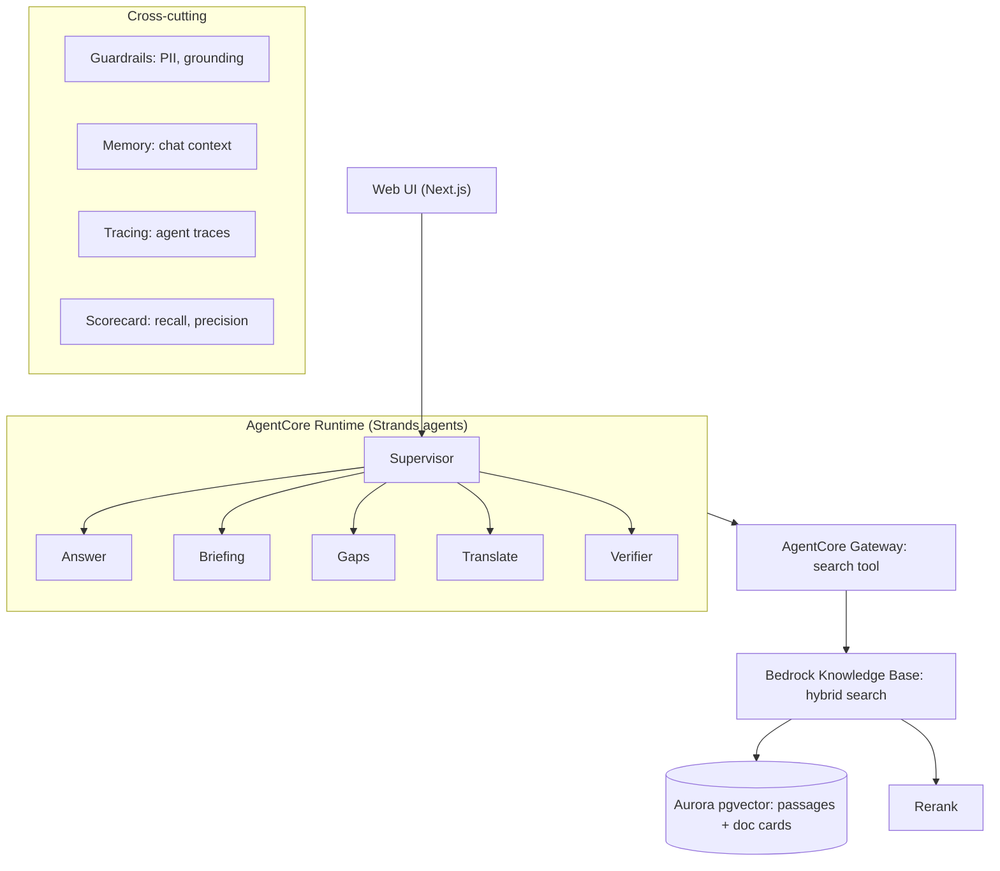
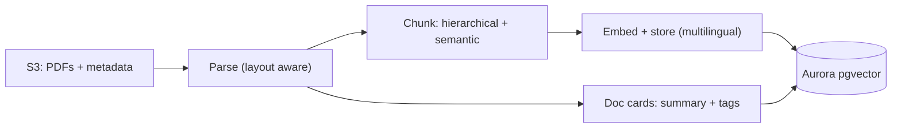

# AskWRI (Team 29)

AWS Breaking Barriers US 2026, World Resources Institute.

AskWRI is a research assistant over WRI publications. It cites a source passage for every claim, checks each sentence against the passage it cites, and declines when the sources don't support an answer. It also shows how complete the search was and how WRI's view on a topic has changed over time.

> Status: planning. Items marked (planned) are not built yet.

## Architecture

### Query path

### Ingestion path

## How it works

1. The UI sends a question to the supervisor agent, which routes to a specialist (answer, briefing, gaps, translate).
2. Specialists search through one tool (AgentCore Gateway). The knowledge base runs hybrid search on Aurora pgvector, then a rerank model reorders results.
3. The verifier checks each sentence against its cited passage and drops unsupported claims. If too little survives, the answer becomes a decline.
4. Two chunk types serve different jobs: passage chunks for answers and citations, and document cards (summary plus tags) for discovery, coverage and time-aware answers.

## Design choices

- Cost: small model for verification and tagging, larger model for final answers, cached repeat queries, Aurora Serverless v2 at a low minimum.
- Security: private encrypted S3, least-privilege IAM, PII filters on questions and answers, no identifiers in memory or traces.
- Evaluation: recall and precision against expected sources, plus a check that unanswerable questions are declined.

## Setup

(planned) Steps to deploy from this repo.
