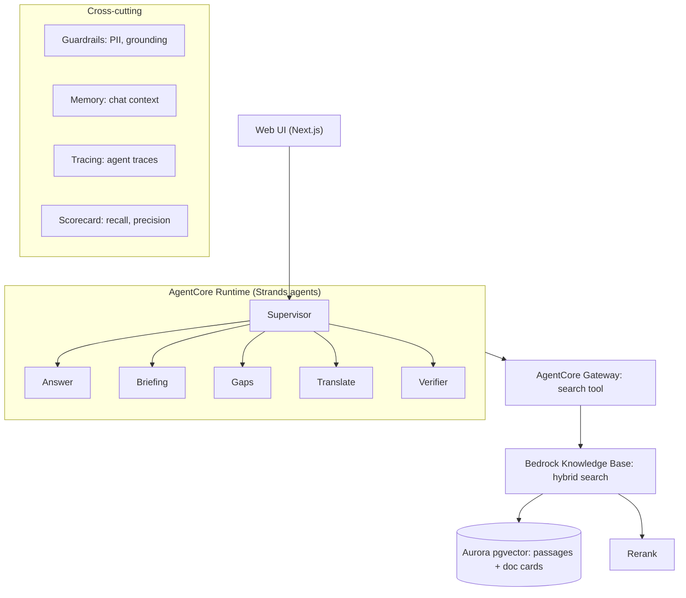
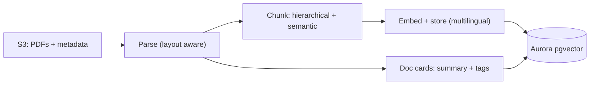

# AskWRI (Team 29)

AWS Breaking Barriers US 2026, World Resources Institute.

AskWRI is a research assistant over WRI publications. It cites a source passage for every claim, checks each sentence against the passage it cites, and declines when the sources don't support an answer. It also shows how complete the search was and how WRI's view on a topic has changed over time.

> Status: planning. Items marked (planned) are not built yet.

## Architecture

### Query path



### Ingestion path



## How it works

1. The UI sends a question to the supervisor agent, which routes to a specialist (answer, briefing, gaps, translate).
2. Specialists search through one tool (AgentCore Gateway). The knowledge base runs hybrid search on Aurora pgvector, then a rerank model reorders results.
3. The verifier checks each sentence against its cited passage and drops unsupported claims. If too little survives, the answer becomes a decline.
4. Two chunk types serve different jobs: passage chunks for answers and citations, and document cards (summary plus tags) for discovery, coverage and time-aware answers.

## Design choices

- Cost: small model for verification and tagging, larger model for final answers, cached repeat queries, Aurora Serverless v2 at a low minimum.
- Security: private encrypted S3, least-privilege IAM, PII filters on questions and answers, no identifiers in memory or traces.
- Evaluation: recall and precision against expected sources, plus a check that unanswerable questions are declined.

## Repository layout

```
.env.example        Template for the local .env (see below)
src/askwri/         Strands agents + AgentCore entrypoint (the agent pipeline above)
api/ ui/            Local FastAPI wrapper and simple chat page for the agents
scripts/            Corpus tooling: build_manifest, download_corpus, ingest, build_gazetteer
eval/               Evaluation questions and runner
data/               Manifests and URL lists (data/raw/ is local only, git-ignored)
prototype/
  backend/          FastAPI service: cited Q&A, map locations, place glances, briefings, graph
  frontend/         Vite + Three.js globe UI with pins, glance cards and the connection map
docs/               Setup guides: guardrails-setup.md, knowledge-base-handoff.md (plus WRI.pdf)
```

`src/` + `api/` and `prototype/` are two separate apps. The prototype reads `BEDROCK_KB_ID` and `BEDROCK_MODEL_ID` and falls back to `KB_ID` and `MODEL_ID`, so one `.env` holds the values for both. Only the prototype loads the file itself. For `src/askwri`, `scripts/` and `eval/`, load it into your shell first: `set -a; source .env; set +a`.

## Local files that are not in git

These are git-ignored and shared between teammates directly. Put them in these exact locations:

| File | Location | Notes |
|---|---|---|
| `.env` | repo root | Copy `.env.example`. It already selects **Claude Sonnet 5.5** (`us.anthropic.claude-sonnet-5-5`) and starts in `DEMO_MODE=true`. Never put AWS access keys in it. The prototype backend loads it automatically; real environment variables win. |
| `data/raw/` | repo root | PDFs fetched by `scripts/download_corpus.py`. Run scripts from the repo root. |
| `.venv/` | `prototype/backend/` and optionally the repo root | Per-app virtual environments. |
| `node_modules/`, `dist/` | `prototype/frontend/` | From `npm ci` and `npm run build`. |

## Safety: guardrails and PII

Follow [`docs/guardrails-setup.md`](docs/guardrails-setup.md) to create the Bedrock guardrail (PII masking, off-topic blocking, grounding checks) from [`docs/guardrail.json`](docs/guardrail.json), then put `GUARDRAIL_ID` and `GUARDRAIL_VERSION` in `.env`. Until then the app runs with safety filters off and says so.

## Sample data mode

While there is no Knowledge Base, `DEMO_MODE=true` serves invented passages, all titled "SAMPLE", under a permanent banner. They go through the same verification code as real answers. When the Knowledge Base is ready, follow [`docs/knowledge-base-handoff.md`](docs/knowledge-base-handoff.md) and set `DEMO_MODE=false`.

## Setup

(planned) Steps to deploy from this repo.

Run the prototype locally. The virtual environment keeps `pip` and `python` on the same interpreter.

Backend (terminal 1):

```
cd prototype/backend
python3 -m venv .venv
source .venv/bin/activate
python -m pip install -r requirements.txt
python -m uvicorn app:app --reload --port 8001
```

Frontend (terminal 2):

```
cd prototype/frontend
npm ci
npm run dev        # http://localhost:5173
```

Tests: `cd prototype/backend && python -m pytest` and `cd prototype/frontend && npm test`.
