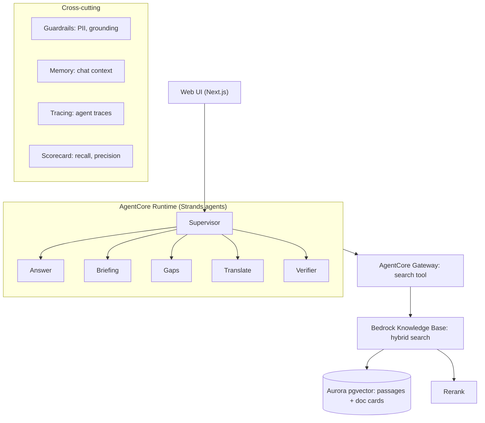
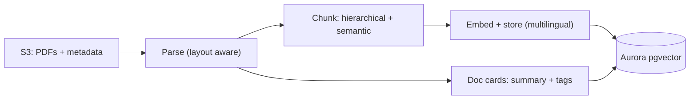

# AskWRI (Team 29)

AWS Breaking Barriers US 2026, World Resources Institute.

AskWRI is a research assistant over WRI publications. It cites a source passage for every claim, checks each sentence against the passage it cites, and declines when the sources don't support an answer. It also shows how complete the search was and how WRI's view on a topic has changed over time.

> Status: planning. Items marked (planned) are not built yet.

## Architecture

### Query path



### Ingestion path



## How it works

1. The UI sends a question to the supervisor agent, which routes to a specialist (answer, briefing, gaps, translate).
2. Specialists search through one tool (AgentCore Gateway). The knowledge base runs hybrid search on Aurora pgvector, then a rerank model reorders results.
3. The verifier checks each sentence against its cited passage and drops unsupported claims. If too little survives, the answer becomes a decline.
4. Two chunk types serve different jobs: passage chunks for answers and citations, and document cards (summary plus tags) for discovery, coverage and time-aware answers.
5. Every question is logged to Demand Radar (no names), which turns the ones AskWRI can't answer well into a ranked list of what WRI should load or research next.

## Demand Radar

Every question AskWRI can't answer well is logged, grouped by topic and ranked, at `/radar`. Not every "no answer" means the same thing, so each gap is sorted by who can fix it:

| Gap type | How it's detected | Action |
|---|---|---|
| Not loaded yet | Declined, but the question matches a report in the WRI catalog that isn't in the searchable corpus | Data Lab loads the report |
| Weak coverage | Answered with a low top retrieval score, or declined although the matching report is loaded | Research teams update or extend the work |
| No match in catalog | Declined, and nothing in the catalog matches | Research leadership: possible new research area |

Clusters are ranked by questions × distinct teams × trend (this window vs the previous one). The page filters by gap type, team and language, and exports a "Top 10 gaps" summary as Markdown.

Privacy: no names or user ids are stored, only the question (emails and phone numbers removed), an optional team label and the retrieval outcome. Rows older than `RADAR_RETENTION_DAYS` (default 90) are deleted.

Current limits, to replace once the AWS sandbox is available:
- **Catalog:** `data/catalog.csv` is a small sample. Replace it with metadata (title, year, program, url) for all WRI reports. No full text is needed.
- **Clustering:** keyword based (TF-IDF), so it can't group questions across languages. Swap in Bedrock multilingual embeddings and one LLM call per cluster for names.
- **Storage:** SQLite (`data/radar.db`). Move to DynamoDB for the deployed version.
- **Demo data:** `scripts/seed_radar.py` adds simulated questions (labelled as simulated on the page). The questions are simulated; the classification and ranking are real.

## Design choices

- Cost: small model for verification and tagging, larger model for final answers, cached repeat queries, Aurora Serverless v2 at a low minimum.
- Security: private encrypted S3, least-privilege IAM, PII filters on questions and answers, no identifiers in memory or traces.
- Evaluation: recall and precision against expected sources, plus a check that unanswerable questions are declined.

## Run locally (no AWS needed)

```bash
pip install fastapi uvicorn pytest httpx
export ASKWRI_MOCK=1                      # keyword search over the manifest titles instead of Bedrock
python scripts/seed_radar.py --reset      # optional: simulated demand for the demo
uvicorn api.server:app --reload           # open http://localhost:8000 and http://localhost:8000/radar
python -m pytest -q tests
```

On Windows PowerShell use `$env:ASKWRI_MOCK = "1"` instead of `export`.

## Setup

(planned) Steps to deploy from this repo.
